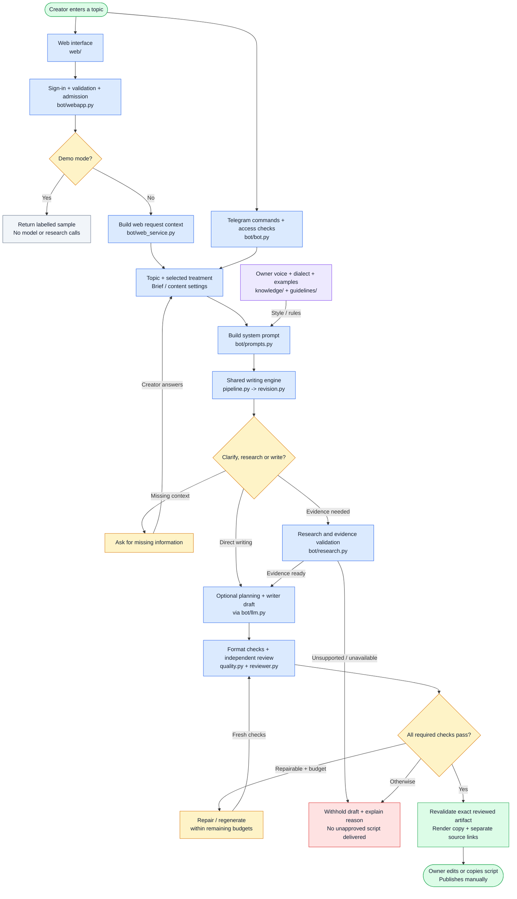
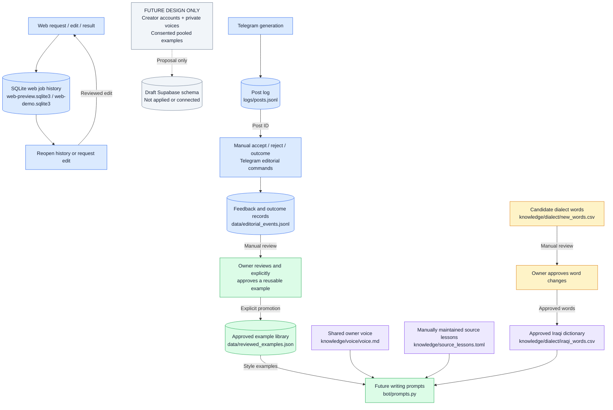
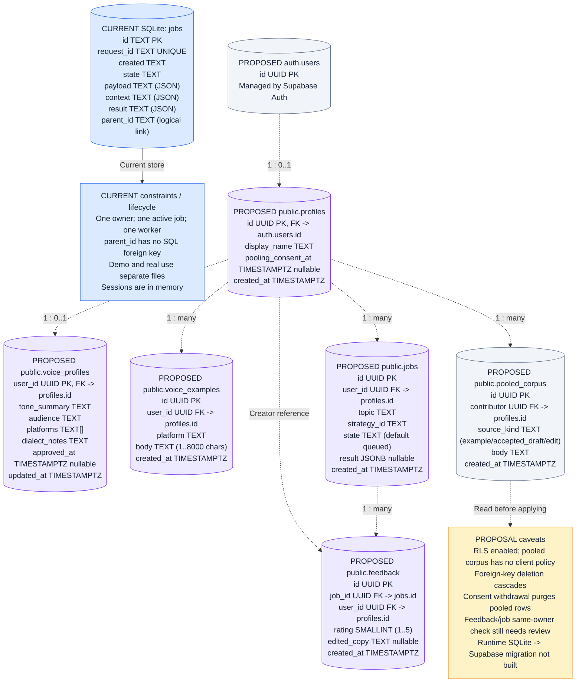

# Content-Writer_Iraqi — repository flowcharts and database structure

Snapshot: `main` at `fceebf5` · 16 November 2026 (Baghdad).

## How to use these files

- This `.md` file contains all three diagrams as editable Mermaid source. GitHub and Mermaid-compatible Markdown viewers can render them.
- For tldraw, download **Content-Writer_Iraqi.tldr** and use the app menu **Open / Open file**. Menu wording may vary. The companion file contains three named pages with editable shapes, text and arrows.
- A Markdown file alone does not guarantee conversion of Mermaid into tldraw shapes. The native companion avoids that conversion.
- The SVG companions can also be dragged onto a canvas as images; their individual boxes will not be native editable shapes.

## Legend

Blue: current interfaces/storage. Green: accepted delivery or explicit owner approval. Yellow: decisions, repair or review. Grey/dashed: future design. No diagram claims a live production deployment has passed acceptance.

## 1. Content request workflow

Current implementation | main fceebf5 | 16 November 2026 | Publication is manual.

## 2. Storage and human-approved learning

Current stores are separate | Feedback does not automatically train a model.

## 3. Database structure

CURRENT: SQLite jobs | PROPOSED: Supabase tables below | PK = primary key, FK = foreign key.

## Database notes

- SQLite `payload`, `context` and `result` are JSON serialized into TEXT; the current SQL schema does not constrain job states or define a foreign key for `parent_id`.
- Telegram pilot settings, post logs, feedback and approved examples are files, not tables in the web SQLite database.
- The proposed Supabase schema has not been applied or connected to the writing engine. It does not yet implement per-creator voice use.
- Proposed relationships show foreign keys; `many` permits zero child rows. A profile can have at most one voice profile because `user_id` is its primary key.
- Before applying Supabase, validate feedback/job ownership, approved voice versions and account isolation. The diagram describes the draft as written, not a security approval.

## Learning notes

- Feedback collection does not automatically train a model, update prompts or promote examples.
- Owner-approved examples and manually curated voice/dialect/source lessons influence future prompts.
- Web history/edit requests and the Telegram feedback/example workflow currently have separate identifiers and stores. The web UI has no equivalent example-promotion interface.
- Dialect word review is a manual workflow; no automatic word extraction worker is shown.

## Configuration and development files

| Repository area | Role |
|---|---|
| `bot/llm.py` | Provider calls, fallback and usage accounting |
| `.env` / hosting settings | Private server configuration; values are excluded from this export |
| `.agents/skills/`, `.claude/` | Coding-assistant guidance and configuration; not content-engine stages |
| `tests/`, `scripts/` | Regression checks, evaluation and frontend build |
| `docs/`, `web/progress.json` | Plans and manually maintained status; not automatic project management |
| `.github/`, `render.yaml`, `vercel.json` | CI and deployment configuration |

## Source files

All links below are pinned to the reviewed revision.

- [Web API and demo](https://github.com/Marketalse/Content-Writer_Iraqi/blob/fceebf5/bot/webapp.py)
- [Web request and delivery boundary](https://github.com/Marketalse/Content-Writer_Iraqi/blob/fceebf5/bot/web_service.py)
- [Shared pipeline and bounded review/revision](https://github.com/Marketalse/Content-Writer_Iraqi/blob/fceebf5/bot/revision.py)
- [Prompt assembly](https://github.com/Marketalse/Content-Writer_Iraqi/blob/fceebf5/bot/prompts.py)
- [Manual feedback and approved examples](https://github.com/Marketalse/Content-Writer_Iraqi/blob/fceebf5/bot/editorial.py)
- [Current SQLite jobs schema](https://github.com/Marketalse/Content-Writer_Iraqi/blob/fceebf5/bot/web_store.py)
- [Proposed Supabase schema](https://github.com/Marketalse/Content-Writer_Iraqi/blob/fceebf5/supabase/migrations/0001_creator_profiles.sql)

These diagrams are a source-code snapshot and do not update automatically.
